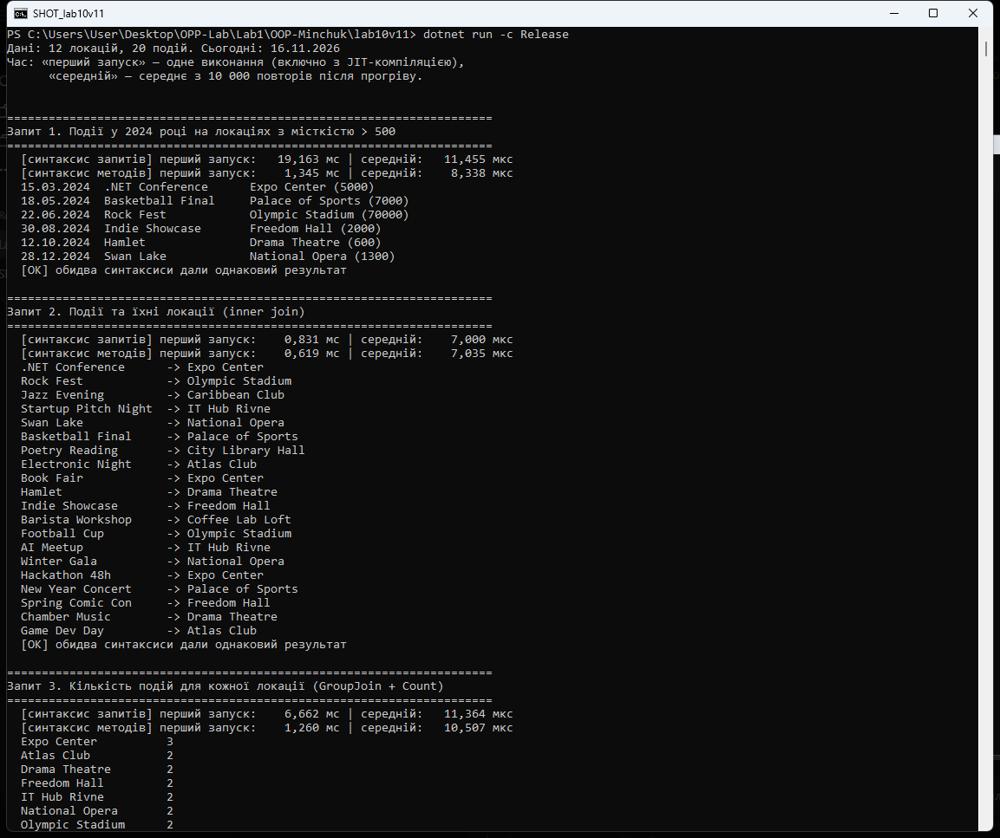
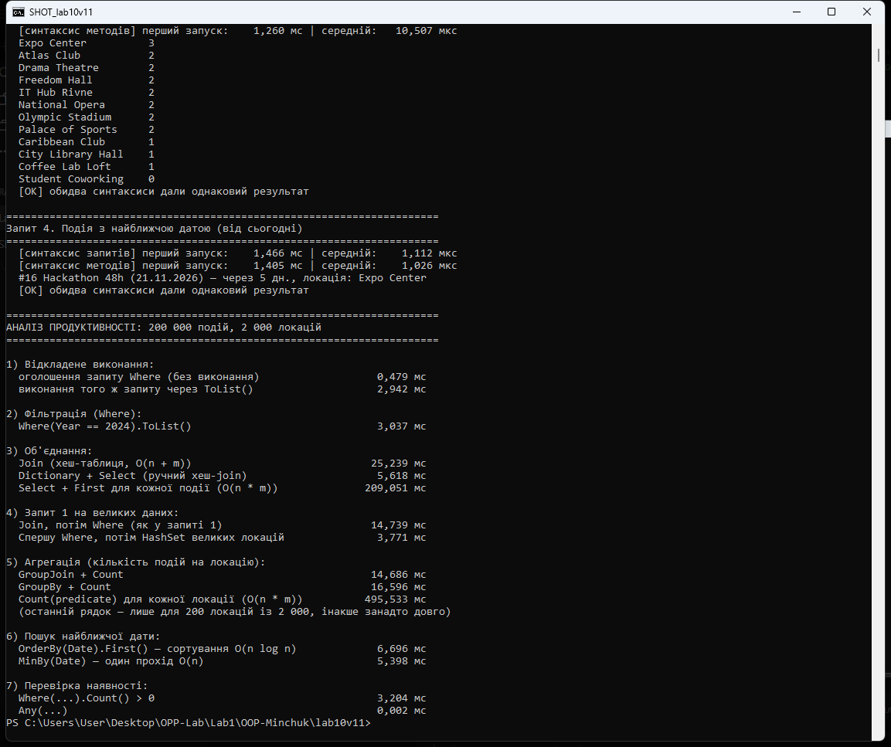

# Звіт до лабораторної роботи №10

**Тема:** LINQ в дії: фільтри, join, агрегації. Продуктивність.
**Варіант:** 11, сценарій «Управління подіями».
**Проєкт:** `OOP-Minchuk/lab10v11` (.NET 10, консольний застосунок).

## 1. Структура проєкту

| Файл | Вміст |
| --- | --- |
| `Models.cs` | Класи сутностей `Event` і `Venue` |
| `DataSeed.cs` | Тестові дані (12 локацій, 20 подій) і генератор великого набору даних |
| `Program.cs` | Чотири запити варіанту в обох синтаксисах, заміри часу `Stopwatch`, аналіз продуктивності |
| `output.txt` | Текстовий вивід програми одного з запусків |
| `screenshots/` | Скріншоти роботи програми |

Запуск: `dotnet run -c Release`.

## 2. Класи сутностей і тестові дані

- **Event** (`Id`, `Name`, `Date`, `LocationId`) — подія. `LocationId` є зовнішнім ключем на `Venue.Id`.
- **Venue** (`Id`, `Name`, `Capacity`) — місце проведення з місткістю.

Тестові дані підібрано так, щоб кожен запит мав показовий результат:

- 12 локацій місткістю від 50 до 70 000 місць. Одна з них, «Student Coworking», не має подій: так видно, як GroupJoin обробляє порожні групи.
- 20 подій з 2023 по 2027 рік. 10 подій припадають на 2024 рік, з них 6 проходять на локаціях місткістю понад 500. Кілька подій заплановано після поточної дати, тож запит 4 знаходить найближчу з них.

Для аналізу продуктивності `DataSeed.Large()` генерує 200 000 подій і 2 000 локацій. Генератор використовує фіксований seed `Random(42)`, тому дані однакові при кожному запуску.

## 3. Опис запитів

Кожен запит написано двічі: у синтаксисі запитів (`from … select`) і в синтаксисі методів. Програма порівнює обидва результати через `SequenceEqual` і виводить `[OK]`, якщо вони збігаються.

**Запит 1. Події у 2024 році на локаціях з місткістю > 500.** Події з'єднуються з локаціями (`join` за `LocationId = Id`), далі фільтр `Date.Year == 2024 && Capacity > 500` і сортування за датою. Результат: 6 подій.

```csharp
from e in events
join v in venues on e.LocationId equals v.Id
where e.Date.Year == 2024 && v.Capacity > 500
orderby e.Date
select new { e.Name, e.Date, Venue = v.Name, v.Capacity }
```

**Запит 2. Події та їхні локації (inner join).** Звичайний `Join`: для кожної події знаходиться її локація, результат — пари «назва події → назва локації». Подія без локації не потрапила б у результат. Результат: 20 пар.

```csharp
events.Join(venues, e => e.LocationId, v => v.Id,
            (e, v) => new { Event = e.Name, Venue = v.Name })
```

**Запит 3. Кількість подій для кожної локації.** `GroupJoin` (у синтаксисі запитів — `join … into`) дає кожній локації колекцію її подій, `Count()` рахує їх. На відміну від `Join`, локація без подій теж залишається в результаті з нулем («Student Coworking — 0»). Сортування: за кількістю за спаданням, потім за назвою.

```csharp
venues.GroupJoin(events, v => v.Id, e => e.LocationId,
                 (v, venueEvents) => new { Venue = v.Name, Count = venueEvents.Count() })
      .OrderByDescending(x => x.Count).ThenBy(x => x.Venue)
```

**Запит 4. Подія з найближчою датою.** Беруться події з датою не раніше сьогоднішньої. У синтаксисі запитів — `orderby e.Date` + `FirstOrDefault()` (сортування всього списку), у синтаксисі методів — `MinBy(e => e.Date)` (один прохід без сортування).

```csharp
events.Where(e => e.Date >= today).MinBy(e => e.Date)
```

## 4. Час виконання запитів

Час виміряно `Stopwatch` у режимі Release. «Перший запуск» — одне виконання разом з JIT-компіляцією, «середній» — середнє з 10 000 повторів після прогріву. Дані — зі скріншота нижче (запуск 16.11.2026).

| Запит | Синтаксис | Перший запуск, мс | Середній, мкс |
| --- | --- | ---: | ---: |
| 1. Події 2024 року, місткість > 500 | запитів | 19,163 | 11,455 |
| | методів | 1,345 | 8,338 |
| 2. Inner join подій і локацій | запитів | 0,831 | 7,000 |
| | методів | 0,619 | 7,035 |
| 3. GroupJoin + Count | запитів | 6,662 | 11,364 |
| | методів | 1,260 | 10,507 |
| 4. Найближча подія | запитів (`orderby` + `First`) | 1,466 | 1,112 |
| | методів (`MinBy`) | 1,405 | 1,026 |

Що видно з таблиці:

- Перший запуск у десятки й сотні разів довший за середній. Це час JIT-компіляції: першим виконується варіант у синтаксисі запитів, тому саме він «платить» за компіляцію спільних методів LINQ (`Join`, `OrderBy`). Тому порівнювати треба середній час.
- Середній час обох синтаксисів майже однаковий: компілятор перетворює синтаксис запитів на виклики тих самих методів. Різниця в 1–3 мкс — це шум вимірювання.
- На 20 подіях усі запити виконуються за мікросекунди, тому різницю між алгоритмами видно лише на великих даних (розділ 5).

## 5. Аналіз продуктивності на великому наборі даних

Ті самі операції виконано на 200 000 подіях і 2 000 локаціях. Час — середнє з 5 запусків (для двох найповільніших — один запуск).

| Операція | Варіант | Час, мс |
| --- | --- | ---: |
| Відкладене виконання | оголошення `Where` без виконання | 0,479 |
| | виконання через `ToList()` | 2,942 |
| Фільтрація | `Where(Year == 2024).ToList()` | 3,037 |
| Об'єднання | `Join` (хеш-таблиця, O(n + m)) | 25,239 |
| | `Dictionary` + `Select` | 5,618 |
| | `Select` + `First` для кожної події (O(n · m)) | 209,051 |
| Запит 1 на великих даних | спершу `Join`, потім `Where` | 14,739 |
| | спершу `Where`, потім `HashSet` локацій | 3,771 |
| Агрегація | `GroupJoin` + `Count` | 14,686 |
| | `GroupBy` + `Count` | 16,596 |
| | `Count(predicate)` для кожної з 200 локацій (O(n · m)) | 495,533 |
| Пошук найближчої дати | `OrderBy(Date).First()` — O(n log n) | 6,696 |
| | `MinBy(Date)` — O(n) | 5,398 |
| Перевірка наявності | `Where(...).Count() > 0` | 3,204 |
| | `Any(...)` | 0,002 |

## 6. Висновок

Найдорожчими виявилися операції, які для кожного елемента знову перебирають іншу колекцію: `Select` + `First` для пошуку локації (209 мс) і `Count(predicate)` для кожної локації (496 мс лише для 200 локацій із 2 000). Їхня складність O(n · m): 200 000 подій × тисячі локацій дають сотні мільйонів порівнянь. Ті самі задачі через `Join`, `GroupJoin` або `Dictionary` виконуються за 5–25 мс, бо LINQ один раз будує хеш-таблицю за ключем, і пошук у ній займає O(1).

Наступні за вартістю — `Join` і `GroupJoin`/`GroupBy` (15–25 мс): вони мусять побудувати хеш-таблицю й створити багато проміжних об'єктів (анонімні типи, групи), що навантажує збирач сміття. Ручний `Dictionary` + `Select` утричі-вчетверо швидший за `Join`, бо не створює пар і не тримає зайвих даних.

Порядок операцій теж важливий: якщо спершу відфільтрувати дані (`Where` + `HashSet` потрібних локацій), запит 1 виконується в 4 рази швидше, ніж коли спочатку з'єднуються всі 200 000 подій. Сортування `OrderBy` лише для того, щоб узяти перший елемент, повільніше за `MinBy`, який проходить колекцію один раз. А `Any` зупиняється на першому знайденому елементі (0,002 мс), тоді як `Count() > 0` перебирає всю колекцію (3,2 мс).

Також видно відкладене виконання: оголошення запиту `Where` майже нічого не коштує (0,5 мс — це лише створення об'єкта-ітератора), а реальна робота відбувається під час `ToList()`. Якщо такий запит перебирати кілька разів без матеріалізації, він виконуватиметься щоразу заново.

Отже, найдорожчі в LINQ — вкладені перебори (O(n · m)), сортування та створення великої кількості проміжних об'єктів. Для швидких запитів варто використовувати `Join`/`Dictionary` замість пошуку в циклі, фільтрувати якомога раніше, брати `Any`, `MinBy`/`MaxBy` замість `Count() > 0` і `OrderBy().First()`, а результат, який використовується кілька разів, матеріалізувати через `ToList()`.

## Скріншоти роботи програми

Запуск `dotnet run -c Release`, початок виводу (запити 1–3):



Кінець виводу (запит 4 і аналіз продуктивності):



## 7. Відповіді на контрольні питання

1. **Синтаксис запитів і синтаксис методів.** Синтаксис запитів (`from … where … select`) схожий на SQL і зручніший для `join`, `group … into`, `let` і запитів з кількома джерелами. Синтаксис методів (`Where`, `Select`, …) охоплює всі оператори, зокрема `Count`, `Any`, `MinBy`, `Take` і `Distinct`, яких немає в синтаксисі запитів. Компілятор перетворює перший на другий, тож швидкодія однакова. Вибір залежить від читабельності конкретного запиту.
2. **Join і GroupJoin.** `Join` — внутрішнє з'єднання: повертає пару для кожного збігу ключів, а елементи без пари відкидає. `GroupJoin` повертає кожен зовнішній елемент разом з колекцією відповідних внутрішніх елементів, зокрема порожньою. Тому `GroupJoin` підходить для підрахунків (запит 3) і для лівого з'єднання (`GroupJoin` + `SelectMany` + `DefaultIfEmpty`).
3. **Агрегуючі операції.** `Count` повертає кількість елементів, `Sum` — суму, `Average` — середнє, `Min`/`Max` — крайні значення, `MinBy`/`MaxBy` — елемент з крайнім значенням ключа. `Aggregate` виконує довільну згортку з акумулятором. Усі вони виконуються негайно й повертають одне значення.
4. **Вимірювання продуктивності.** Простий спосіб — `System.Diagnostics.Stopwatch` навколо матеріалізованого запиту, з прогрівом і усередненням кількох запусків. Точніші результати дає BenchmarkDotNet. На швидкодію впливають алгоритмічна складність (вкладені цикли проти хеш-таблиць), кількість проміжних об'єктів і робота GC, порядок операцій (спершу фільтрувати, потім сортувати), повторні перебори через відкладене виконання, JIT-компіляція першого виклику та режим збірки (Debug чи Release).
